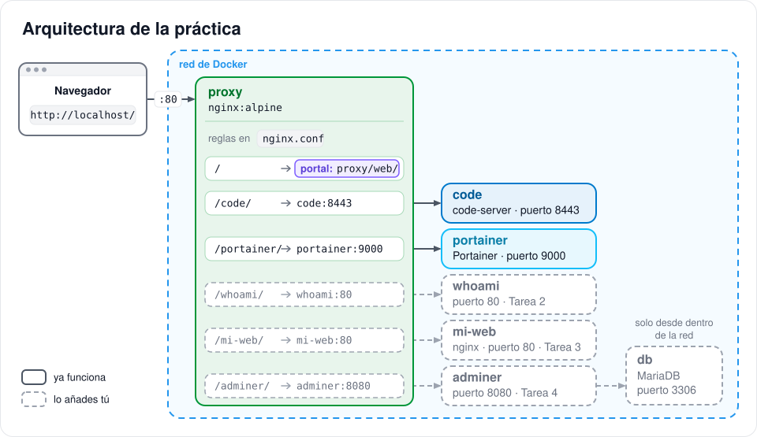
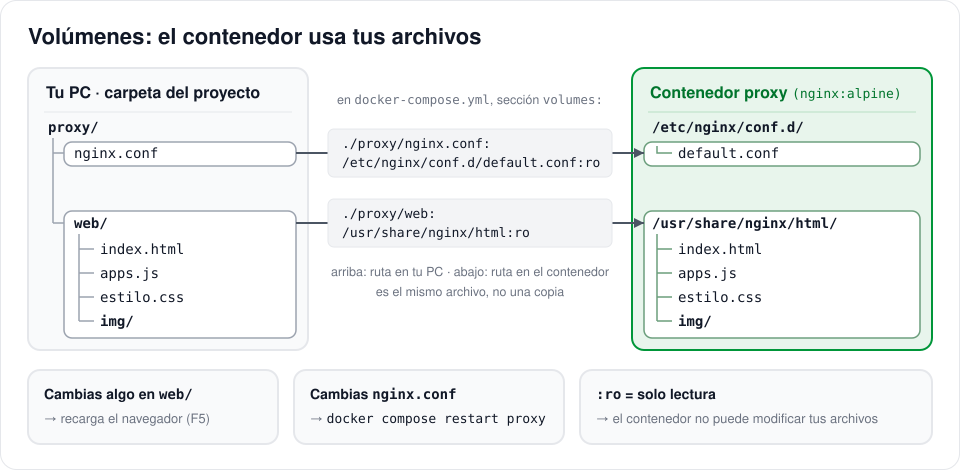
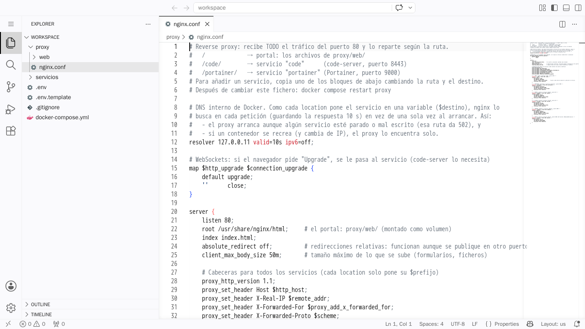
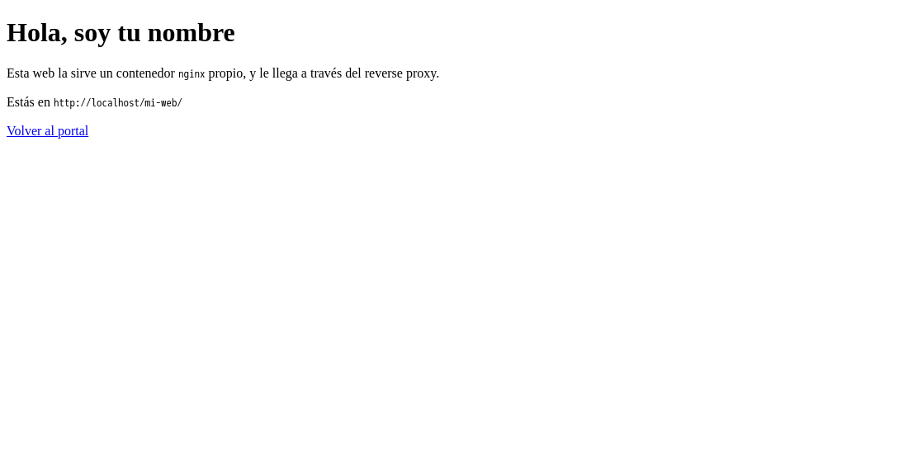
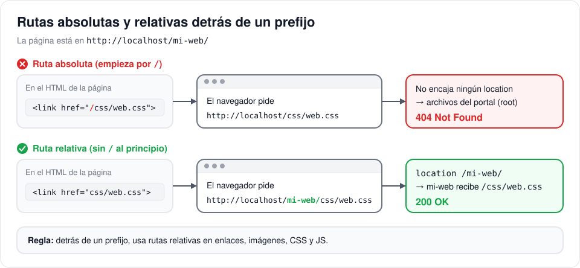
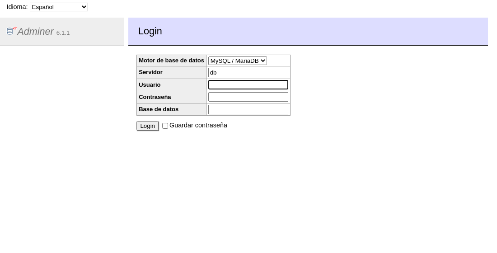
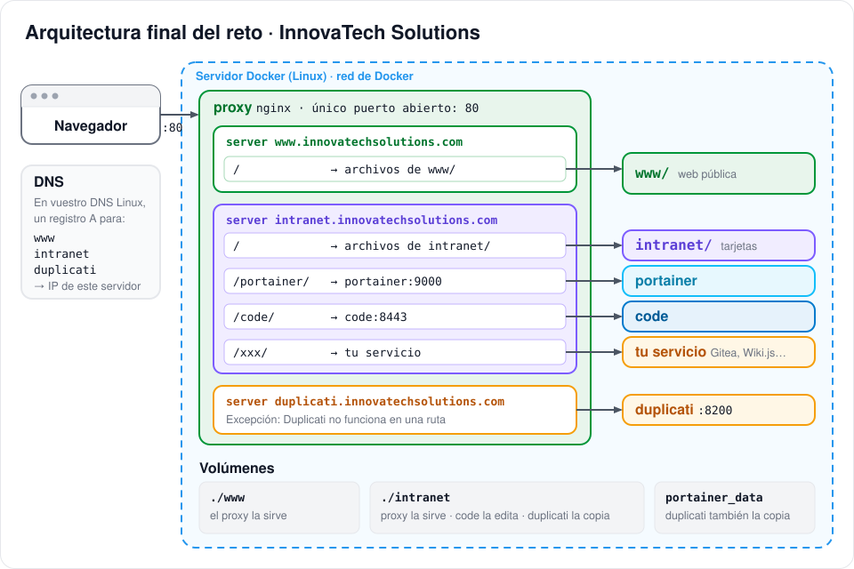
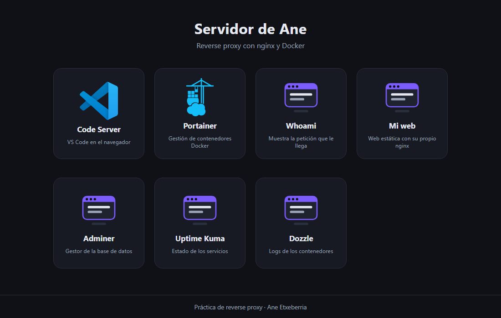

# 🔀 Práctica: reverse proxy con nginx y Docker

En esta práctica vas a montar un **reverse proxy**: un único nginx que recibe todas las peticiones en el puerto 80 y las reparte entre varios servicios. Puede repartirlas de dos formas, **por ruta** (`localhost/code/`, `localhost/portainer/`…) o **por subdominio** (`code.localhost`, `kuma.localhost`…), y las dos se pueden combinar en el mismo proxy. Es lo que hay delante de casi cualquier servidor real.

No empiezas de cero. El repositorio ya trae un entorno que funciona, con el proxy, un portal de inicio, code-server y Portainer, y tu trabajo consiste en ampliarlo con nuevos servicios, tarea a tarea.

**Índice**

- [🎯 Qué vas a hacer](#-qué-vas-a-hacer)
- [🧠 Conceptos](#-conceptos)
  - [¿Qué es un reverse proxy?](#qué-es-un-reverse-proxy)
  - [Arquitectura de la práctica](#arquitectura-de-la-práctica)
  - [El `docker-compose.yml`](#el-docker-composeyml)
  - [El `nginx.conf`](#el-nginxconf)
  - [Rutas o subdominios: dos formas de repartir](#rutas-o-subdominios-dos-formas-de-repartir)
- [🛠️ Tareas](#️-tareas)
  - [Tarea 1 · Arranca el entorno y explóralo](#tarea-1--arranca-el-entorno-y-explóralo)
  - [Tarea 2 · Tu primer servicio: whoami](#tarea-2--tu-primer-servicio-whoami)
  - [Tarea 3 · Publica una web estática](#tarea-3--publica-una-web-estática)
  - [Tarea 4 · Adminer y una base de datos](#tarea-4--adminer-y-una-base-de-datos)
  - [Tarea 5 · Publica por subdominio y combina las dos formas](#tarea-5--publica-por-subdominio-y-combina-las-dos-formas)
  - [⭐ Reto · Un servicio que conoce su prefijo](#-reto--un-servicio-que-conoce-su-prefijo)
- [🏁 Hacia el reto: la arquitectura final](#-hacia-el-reto-la-arquitectura-final)
- [🔄 Cómo aplicar los cambios](#-cómo-aplicar-los-cambios)
- [🩺 Problemas frecuentes](#-problemas-frecuentes)
- [📤 Entrega](#-entrega)

---

## 🎯 Qué vas a hacer

Primero arrancarás el entorno y pondrás tu nombre en el portal. Después publicarás detrás del proxy un servicio nuevo en cada tarea: **whoami** en `/whoami/`, con todos los pasos explicados; una **web estática** en `/mi-web/`, en la que tendrás que arreglar un fallo; y **Adminer** en `/adminer/`, con una base de datos detrás. En la Tarea 5 cambiarás de forma de publicar y darás a algunos servicios su propio nombre, `whoami.localhost` y `kuma.localhost`. Si te sobra tiempo, el ⭐ Reto opcional consiste en publicar **Dozzle** en `/dozzle/`.

Necesitas tener instalados **Docker Desktop** (o Docker Engine con `docker compose`) y **Git**. Todos los comandos de la práctica se ejecutan en una **terminal abierta en la carpeta del proyecto**, la que contiene `docker-compose.yml`. En Windows usa PowerShell o Git Bash, no CMD.

---

## 🧠 Conceptos

### ¿Qué es un reverse proxy?

Un reverse proxy es un servidor que se pone **delante** de tus servicios y hace de recepcionista. Todas las visitas entran por la misma puerta, el puerto 80, y él decide, mirando la URL, a qué servicio pasa cada petición.


La primera ventaja es la seguridad: solo hay **un puerto abierto**, y a los servicios únicamente se puede llegar a través del proxy. La segunda es la comodidad, porque las URLs son fáciles de recordar: `http://localhost/portainer/` en vez de `http://localhost:9000`. Y además el proxy se convierte en **un único punto de control** donde, más adelante, se pueden añadir HTTPS, contraseñas, límites o logs para todos los servicios a la vez.

### Arquitectura de la práctica



El diagrama muestra la parte por ruta, que es la que montarás en las Tareas 1 a 4. En la Tarea 5 añadirás además dos **nombres**, `whoami.localhost` y `kuma.localhost`, que entran por el mismo puerto 80 y llegan al mismo proxy.

Los ficheros del proyecto están organizados así:

```text
nginx-reverse-proxy/
├── docker-compose.yml     ← los servicios (contenedores)
├── .env.template          ← plantilla de contraseñas (cópiala como .env)
├── proxy/
│   ├── nginx.conf         ← las reglas del reverse proxy
│   └── web/               ← el portal de inicio (http://localhost/)
│       ├── index.html
│       ├── apps.js        ← las cajas del portal: una por servicio
│       ├── estilo.css
│       └── img/           ← iconos (generica.svg sirve para cualquier servicio)
└── servicios/
    └── mi-web/            ← la web de la Tarea 3
```

### El `docker-compose.yml`

El proxy es un `nginx:alpine` **sin Dockerfile**. No hace falta construir ninguna imagen, porque la configuración y la web del portal se le pasan como **volúmenes**:

```yaml
services:
  proxy:
    image: nginx:alpine
    restart: unless-stopped
    ports:
      - "80:80"                 # el ÚNICO puerto publicado de todo el proyecto
    volumes:
      - ./proxy/nginx.conf:/etc/nginx/conf.d/default.conf:ro   # la configuración
      - ./proxy/web:/usr/share/nginx/html:ro                   # la web del portal

  portainer:                    # sin "ports": solo se llega a través del proxy
    image: portainer/portainer-ce:latest
    ...
```

Fíjate en que **solo el proxy tiene `ports`**. El resto de servicios viven en la red interna de Docker, y desde el navegador no se puede entrar en ellos directamente. Dentro de esa red, **el nombre de cada servicio funciona como su dirección**: el proxy llega a Portainer escribiendo `portainer:9000` y a code-server escribiendo `code:8443`, porque Docker hace de DNS y traduce esos nombres a la IP de cada contenedor.

Un volumen hace que el contenedor use **tus archivos**, no una copia. Por eso, si cambias algo en `proxy/web/`, basta con recargar el navegador para verlo.



### El `nginx.conf`

Cada servicio publicado por ruta ocupa un bloque como este, que es el de Portainer:

```nginx
# --- PORTAINER: /portainer/ → servicio "portainer", puerto 9000 ---
location = /portainer { return 301 /portainer/; }
location /portainer/ {
    set $prefijo /portainer;
    set $destino portainer:9000;
    rewrite ^/portainer(/.*)$ $1 break;
    proxy_pass http://$destino;
}
```

| Línea | Qué hace |
|---|---|
| `location = /portainer { return 301 /portainer/; }` | Si alguien escribe `/portainer` sin la barra final, lo redirige a `/portainer/` |
| `location /portainer/ {` | Este bloque atiende **todas** las rutas que empiezan por `/portainer/` |
| `set $prefijo /portainer;` | Se envía al servicio en la cabecera `X-Forwarded-Prefix`, por si quiere saber bajo qué ruta está publicado |
| `set $destino portainer:9000;` | **Nombre del servicio** en el `docker-compose.yml` **:** **puerto interno** en el que escucha |
| `rewrite ^/portainer(/.*)$ $1 break;` | **Quita el prefijo:** `/portainer/api/status` pasa a ser `/api/status` |
| `proxy_pass http://$destino;` | Reenvía la petición al servicio y devuelve su respuesta al navegador |

La línea del `rewrite` es la más difícil de leer. Dice lo siguiente: «si la ruta empieza por `/portainer`, guarda lo que viene detrás (`(/.*)`) y quédate solo con eso (`$1`)». El `break` final significa «ya está, no apliques más reglas y sigue con el `proxy_pass`». Cuando copies este bloque para otro servicio, recuerda que el prefijo aparece **cinco veces** y el nombre del servicio una, dentro de `$destino`, y que tienes que cambiarlos todos.

El diagrama siguiente muestra el viaje completo de una petición:


Puedes comprobarlo tú mismo abriendo <http://localhost/portainer/api/status>. Verás la respuesta JSON de Portainer, que ha recibido la petición como `/api/status`. Cuando una ruta no encaja con ningún `location`, como `/apps.js`, nginx la busca como archivo del portal, y si ese archivo no existe responde con un `404`.

Al principio del fichero hay tres cosas más que no tienes que tocar, pero que conviene entender.

La primera son **las cabeceras `proxy_set_header`**. Una *cabecera* es un dato extra que viaja con cada petición HTTP además de la URL: para qué nombre va (`Host`), desde qué navegador, desde qué IP… Las que añade el proxy (`X-Real-IP`, `X-Forwarded-For`…) le cuentan al servicio quién hizo la petición original, porque sin ellas el servicio solo vería que le llama el proxy. Las verás en directo en la Tarea 2. Están escritas **fuera** de los bloques `server` para que las hereden todos, también los de subdominio de la Tarea 5.

La segunda es **el bloque `map … $connection_upgrade`**, que deja pasar los **WebSockets**, un tipo de conexión que se queda abierta en lugar de cerrarse tras cada petición. code-server no funciona sin ellos.

La tercera es **`resolver 127.0.0.11`**, que junto con `set $destino` hace que nginx busque cada servicio **en cada petición**, en vez de una sola vez al arrancar. Gracias a eso el proxy arranca aunque un servicio esté parado o mal escrito: solo falla la ruta de ese servicio, con un `502`, y el resto sigue funcionando.

### Rutas o subdominios: dos formas de repartir

> 📌 Esta sección la necesitas en la **Tarea 5**. Si es tu primera lectura, puedes saltar a las [Tareas](#️-tareas) y volver aquí cuando llegues.

Hasta ahora el proxy decide **mirando la ruta**, es decir, lo que va después del nombre. Pero también puede decidir **mirando el nombre** que has escrito en el navegador. Imagina un edificio de oficinas con un solo portal (el puerto 80) y un recepcionista (nginx). Publicar por ruta es como decirle «voy a la planta 3»: todos llegan a la misma dirección y el recepcionista te manda por el pasillo que toca. Publicar por subdominio es como si cada empresa del edificio tuviera **su propio rótulo y su propia dirección**, aunque físicamente todas compartan el mismo portal.

En el `nginx.conf` la diferencia se ve así. Un servicio publicado por ruta, como `http://localhost/code/`, es un `location /code/` dentro del `server` principal, y necesita el `rewrite` para quitar el prefijo. Un servicio publicado por subdominio, como `http://code.localhost/`, tiene su propio bloque `server { }` con `server_name code.localhost`, y no necesita `rewrite` porque el servicio está en `/`, como si fuera el único del servidor. Por eso por subdominio funcionan también los servicios que no admiten estar en una subruta, como Uptime Kuma.

Cuando el fichero tiene bloques de los dos tipos, nginx decide en dos pasos y siempre en el mismo orden. Primero elige **el `server`**: compara el nombre de la petición (la cabecera `Host`) con los `server_name`, y si ninguno encaja, la atiende el que lleva `default_server`, que en esta práctica es el servidor principal con el portal y las rutas. Después, dentro del `server` elegido, elige **el `location`** comparando la ruta. Estos tres ejemplos muestran el camino completo:

```text
http://kuma.localhost/dashboard   → server kuma.localhost  → location /          → kuma:3001  recibe /dashboard
http://localhost/code/            → server principal       → location /code/     → code:8443  recibe /
http://localhost/kuma/            → server principal       → ningún location     → 404 del portal
```

Combinar las dos formas es tan sencillo como tener los dos tipos de bloque en el mismo `nginx.conf`: el `server` principal, con el portal y las rutas, y un `server` por cada subdominio. Un mismo servicio puede incluso publicarse de las dos formas a la vez, porque cada bloque es solo una puerta más hacia el mismo contenedor. Lo razonable es publicar por ruta el portal y los servicios que funcionan bien detrás de un prefijo (code-server, Portainer, Adminer…), y por subdominio los que no admiten subruta o usan rutas absolutas (Uptime Kuma y muchas webs), además de los que queremos que tengan una dirección «limpia», como `www` o `intranet`.

Para que un nombre llegue al proxy, tiene que **resolver a la IP del proxy**. En tu PC no tienes que hacer nada si usas nombres terminados en `.localhost`, porque Chrome, Edge y Firefox los resuelven solos a `127.0.0.1`. En un servidor real con dominio propio, en cambio, hay que crear en el DNS un registro `A` por cada nombre, apuntando a la IP del servidor.

> Si publicas el proxy en otro puerto (`"8080:80"`), el puerto va detrás del nombre: `http://kuma.localhost:8080/`. nginx compara el nombre sin el puerto, así que el `server_name` no cambia.

---

## 🛠️ Tareas

### Tarea 1 · Arranca el entorno y explóralo

**1. Clona tu repositorio y crea el `.env`.**

```bash
git clone <url-de-tu-repositorio>   # la URL del botón "Code" de tu repositorio en GitHub
cd nginx-reverse-proxy              # o el nombre que tenga la carpeta que se ha creado
cp .env.template .env
```

Abre el fichero `.env` y cambia `cambiame` por una contraseña tuya, que será la de code-server. Docker Compose lee este fichero automáticamente, y `docker-compose.yml` usa el valor con la expresión `${CODE_PASSWORD:?mensaje}`, que significa «coge la variable del `.env` y, si no existe, para y muestra este mensaje». El `.env` está en `.gitignore`, así que nunca se sube a GitHub.

**2. Arranca todo y comprueba el estado.** La primera vez Docker tiene que descargar las imágenes, así que tardará unos minutos.

```bash
docker compose up -d
docker compose ps
```

La salida será parecida a esta, aunque la tuya tendrá más columnas:

```text
SERVICE     STATUS         PORTS
code        Up 5 seconds   8443/tcp
portainer   Up 5 seconds   8000/tcp, 9000/tcp, 9443/tcp
proxy       Up 5 seconds   0.0.0.0:80->80/tcp
```

Solo `proxy` tiene un puerto publicado (`0.0.0.0:80->80`). Los demás muestran únicamente sus puertos internos, que no son accesibles desde fuera de Docker.

**3. Abre <http://localhost/>.** Lo que ves es el portal, que sirve el propio proxy desde la carpeta `proxy/web/`.


**4. Entra en Code Server** (`/code/`) con la contraseña que pusiste en el `.env`. Es VS Code funcionando en el navegador, abierto sobre la carpeta del proyecto, así que puedes editar los ficheros de la práctica desde aquí o desde el VS Code de tu PC: es la misma carpeta y da igual cuál elijas. Si te pregunta si confías en la carpeta, pulsa **Trust**.



**5. Entra en Portainer** (`/portainer/`) y crea el usuario administrador. ⏱️ **Hazlo nada más arrancar**, porque Portainer solo da **5 minutos** para crear el usuario. Si se pasa ese tiempo, al entrar en `/portainer/` verás un `404` en `/timeout.html`; en ese caso ejecuta `docker compose restart portainer` y vuelve a intentarlo.

La contraseña tiene que tener **al menos 12 caracteres**. Además, Portainer te pedirá un **setup token**, un código que escribe en sus logs cada vez que arranca. Puedes encontrarlo con este comando:

```bash
docker compose logs portainer | grep setup_token              # Git Bash, Linux, macOS
docker compose logs portainer | Select-String setup_token     # PowerShell
```

```text
portainer-1  | setup_token=64752a9c...
```


**6. Personaliza el portal.** Edita `proxy/web/apps.js` y cambia el título y el pie, poniendo tu nombre:

```js
const PORTAL = {
  titulo: 'Servidor de Ane',
  subtitulo: 'Reverse proxy con nginx y Docker',
  pie: 'Práctica de reverse proxy · Ane Etxeberria',
};
```

Guarda y recarga el navegador con F5. No hace falta reiniciar nada, porque `proxy/web/` es un volumen.

✅ **Comprueba** que el portal muestra tu nombre, que puedes entrar en code-server y en Portainer, y que <http://localhost:9000> **no** responde, porque a Portainer solo se llega a través del proxy.

---

### Tarea 2 · Tu primer servicio: whoami

[whoami](https://github.com/traefik/whoami) es un servidor web diminuto que responde mostrando **la petición que le ha llegado**. Eso lo hace perfecto para ver qué hace el proxy con cada petición antes de pasársela.

**1. Añade el servicio** en `docker-compose.yml`, sin `ports`. Tiene que ir al final de la sección `services:`, es decir, **después de `portainer:` y antes de la línea `volumes:`**, donde hay un comentario que marca el sitio. Respeta la misma sangría de dos espacios que tienen los demás servicios:

```yaml
  whoami:                       # → /whoami/
    image: traefik/whoami
    restart: unless-stopped
```

Por dentro, el fichero tiene que quedar con esta estructura:

```yaml
services:
  proxy: …
  code: …
  portainer: …
  whoami: …          # ← el nuevo, dentro de services

volumes:
  …
```

Después arranca el nuevo contenedor:

```bash
docker compose up -d
```

**2. Añade su bloque** en `proxy/nginx.conf`, dentro del `server` principal. Va después del bloque de Portainer y **antes de la `}` que cierra el `server`**; también aquí hay un comentario que marca el sitio. whoami escucha en el puerto **80**:

```nginx
    # --- WHOAMI: /whoami/ → servicio "whoami", puerto 80 ---
    location = /whoami { return 301 /whoami/; }
    location /whoami/ {
        set $prefijo /whoami;
        set $destino whoami:80;
        rewrite ^/whoami(/.*)$ $1 break;
        proxy_pass http://$destino;
    }
```

**3. Reinicia el proxy** para que lea la nueva configuración, y mira sus logs por si hay algún error:

```bash
docker compose restart proxy
docker compose logs proxy
```

Verás varias líneas de arranque, como `docker-entrypoint.sh` o `Configuration complete`, que son normales. Si no aparece ninguna línea con `[emerg]`, la configuración está bien.

**4. Prueba** <http://localhost/whoami/hola>. Verás algo parecido a esto, aunque tus IPs serán otras:

```text
Hostname: 5d30021cbe95
IP: 127.0.0.1
IP: 172.22.0.5
RemoteAddr: 172.22.0.4:49914          ← quién le habla: el PROXY
GET /hola HTTP/1.1                    ← la ruta que le llega: SIN /whoami
Host: localhost
User-Agent: Mozilla/5.0 (...)
X-Forwarded-For: 172.22.0.1           ← quién hizo la petición original: tu PC (la IP con la que Docker lo ve)
X-Forwarded-Prefix: /whoami           ← bajo qué ruta está publicado
X-Forwarded-Proto: http
X-Real-Ip: 172.22.0.1
```

Fíjate en la línea `GET /hola`: aunque tú pediste `/whoami/hola`, a whoami le llega la ruta sin el prefijo, porque el `rewrite` lo ha quitado por el camino.

**5. Añádelo al portal** en `proxy/web/apps.js`, dentro de la lista `APPS`. La caja nueva va después de la de Portainer y **antes del `];` que cierra la lista**, donde hay otro comentario que marca el sitio:

```js
  {
    nombre: 'Whoami',
    ruta: '/whoami/',                  // la misma ruta que su location
    imagen: 'img/generica.svg',        // o descarga un icono en img/
    descripcion: 'Muestra la petición que le llega',
  },
```

✅ **Comprueba** que <http://localhost/whoami/hola> muestra `GET /hola` y que la caja de Whoami aparece en el portal.

---

### Tarea 3 · Publica una web estática

En la carpeta `servicios/mi-web/` tienes una web sencilla. Esta vez no la servirá el proxy, sino **su propio contenedor nginx**, y el proxy se limitará a publicarla en `/mi-web/`.

**1. Añade el servicio.** Es la misma idea que el proxy: un `nginx:alpine` con la web montada como volumen. Va en el mismo sitio del `docker-compose.yml` que whoami.

```yaml
  mi-web:                       # → /mi-web/
    image: nginx:alpine
    restart: unless-stopped
    volumes:
      - ./servicios/mi-web:/usr/share/nginx/html:ro
```

**2. Escribe tú el bloque** en `nginx.conf`, en el mismo sitio que el de whoami. La ruta es `/mi-web/`, el servicio se llama `mi-web` y escucha en el puerto `80`. Lo más fácil es copiar el bloque de whoami y cambiar `whoami` por `mi-web` en **las seis veces** que aparece, sin contar el comentario; el guion del nombre no da ningún problema en nginx. Cuando termines, arranca el contenedor con `docker compose up -d` y reinicia el proxy.

**3. Abre <http://localhost/mi-web/>.** Verás que algo falla, porque la página sale **sin estilos**, como en la imagen de la izquierda. Al terminar la tarea tendrá que verse como la de la derecha.

<p align="center">
  
  
</p>

**4. Investiga qué pasa.** Pulsa **F12**, abre la pestaña **Red** (Network) y recarga la página. Verás que el archivo `web.css` da **404** y que el navegador lo ha pedido a `http://localhost/css/web.css`, fuera de `/mi-web/`. La causa está en el `<link>` de `servicios/mi-web/index.html`:

```html
<link rel="stylesheet" href="/css/web.css">
```

Como la ruta empieza por `/`, es una ruta **absoluta**, y el navegador la busca en la raíz del servidor. Pero la raíz del servidor es el portal, no tu web, y en el portal no hay ningún `css/web.css`.



**5. Arréglalo** quitando la `/` inicial, de forma que quede `href="css/web.css"`, y recarga con F5. Como la web es un volumen, el cambio se ve al momento, sin reiniciar nada. Aprovecha para poner tu nombre en el `<h1>`.

> El enlace **Volver al portal** (`href="/"`) sí es absoluto, y es a propósito: en ese caso queremos salir de `/mi-web/` e ir a la raíz.

**6. Añádela al portal** en `apps.js`, igual que hiciste con whoami.

✅ **Comprueba** que <http://localhost/mi-web/> se ve con estilos y con tu nombre, que en **F12 → Red** el archivo `web.css` da `200`, y que la caja aparece en el portal.

---

### Tarea 4 · Adminer y una base de datos

[Adminer](https://www.adminer.org/) es un gestor de bases de datos que funciona en el navegador. Vas a publicarlo en `/adminer/` con una base de datos MariaDB detrás. La base de datos, en cambio, **no se publica**: solo Adminer habla con ella, dentro de la red de Docker.

**1. Añade la contraseña de la base de datos** al `.env` y también a `.env.template`, para que quien clone tu repositorio sepa que tiene que ponerla. En `.env` escribe una contraseña tuya; en `.env.template` deja `cambiame`.

```bash
# Contraseña del usuario root de MariaDB
DB_PASSWORD=cambiame
```

> MariaDB fija la contraseña **la primera vez que arranca**. Si después la cambias en `.env`, la base de datos seguirá con la antigua (lo tienes explicado en [Problemas frecuentes](#-problemas-frecuentes)).

**2. Añade los dos servicios** en `docker-compose.yml`, en el mismo sitio que los anteriores:

```yaml
  db:                           # base de datos: NO pasa por el proxy
    image: mariadb:11
    restart: unless-stopped
    environment:
      MARIADB_ROOT_PASSWORD: "${DB_PASSWORD:?Falta DB_PASSWORD en .env}"
      MARIADB_DATABASE: clase
    volumes:
      - db_datos:/var/lib/mysql

  adminer:                      # → /adminer/
    image: adminer
    restart: unless-stopped
    environment:
      ADMINER_DEFAULT_SERVER: db
```

La línea `${DB_PASSWORD:?Falta DB_PASSWORD en .env}` usa la misma sintaxis que `CODE_PASSWORD`: lee la variable del `.env` y, si no existe, `docker compose` se para con ese mensaje. Cópiala tal cual.

La base de datos guarda sus datos en un volumen nuevo, `db_datos`, que tienes que declarar al final del fichero, en la sección `volumes:`:

```yaml
volumes:
  code_config:
  portainer_data:
  db_datos:
```

**3. Escribe el bloque** de `/adminer/` en `nginx.conf`, igual que hiciste con `mi-web`, teniendo en cuenta que Adminer escucha en el puerto **8080**. Después arranca los contenedores con `docker compose up -d` y reinicia el proxy.

**4. Entra en <http://localhost/adminer/>** con el servidor `db`, el usuario `root`, la contraseña del `.env` y la base de datos `clase`. Fíjate en que el servidor se llama `db`: otra vez, el nombre del servicio funciona como dirección dentro de la red de Docker.

> La primera vez, MariaDB tarda entre 10 y 20 segundos en prepararse. Si Adminer dice que no puede conectar, no toques nada: espera un poco y vuelve a intentarlo. Sabrás que está lista cuando `docker compose logs db` termine con `ready for connections`.



**5. Añádelo al portal** con su caja en `apps.js`.

✅ **Comprueba** que entras en Adminer y ves la base de datos `clase` (todavía vacía), que su caja está en el portal y que <http://localhost:8080> **no** responde, porque Adminer, igual que la base de datos, solo se alcanza desde dentro de la red de Docker.

---

### Tarea 5 · Publica por subdominio y combina las dos formas

Hasta ahora todos los servicios cuelgan de `localhost/…`. En esta tarea vas a dar a algunos de ellos **su propio nombre**, sin tocar las rutas que ya funcionan. Antes de empezar, repasa la sección [Rutas o subdominios](#rutas-o-subdominios-dos-formas-de-repartir).

**1. Publica whoami también por subdominio.** No necesitas un contenedor nuevo, porque es el mismo whoami de la Tarea 2. Al final de `proxy/nginx.conf`, **fuera** del `server` principal, añade un bloque `server` propio. Tienes una plantilla comentada al final del fichero:

```nginx
# --- WHOAMI por subdominio: whoami.localhost → servicio "whoami", puerto 80 ---
server {
    listen 80;
    server_name whoami.localhost;
    set $prefijo "";

    location / {
        set $destino whoami:80;
        proxy_pass http://$destino;
    }
}
```

Fíjate en lo que **no** está: no hay `rewrite` ni redirección de la barra final, porque no hay ningún prefijo que quitar. La línea `set $prefijo "";` hace falta porque la cabecera común `X-Forwarded-Prefix` usa esa variable y nginx se queja si no está definida; como la dejamos vacía, la cabecera no se envía.

Reinicia el proxy y abre <http://whoami.localhost/hola>. whoami recibe `GET /hola`, igual que en <http://localhost/whoami/hola>, que sigue funcionando, pero esta vez sin necesidad de `rewrite`. Es el mismo contenedor, publicado de **las dos formas a la vez**.

> Si `whoami.localhost` no abre, es que tu navegador no resuelve los nombres `*.localhost`. Prueba con Chrome, Edge o Firefox, que lo hacen solos. Si aun así no funciona, añade la línea `127.0.0.1 whoami.localhost` a tu fichero `hosts`, para lo que necesitas permisos de administrador.

**2. Publica Uptime Kuma, un servicio que necesita subdominio.** [Uptime Kuma](https://github.com/louislam/uptime-kuma) vigila si tus servicios están en marcha. No funciona en una subruta, así que es el candidato perfecto para un subdominio. Añade el servicio en el mismo sitio del `docker-compose.yml` que los anteriores:

```yaml
  kuma:                         # → http://kuma.localhost/
    image: louislam/uptime-kuma:1
    restart: unless-stopped
    volumes:
      - kuma_datos:/app/data
```

Declara también `kuma_datos:` en la sección `volumes:`, y escribe **tú** su bloque `server`, con `server_name kuma.localhost`, siguiendo el de whoami. Kuma escucha en el puerto **3001** y usa WebSockets, que ya están cubiertos por las cabeceras comunes. Arranca con `docker compose up -d` y reinicia el proxy.

Después abre <http://kuma.localhost/>, crea el usuario y añade un monitor HTTP para cada servicio. Usa sus nombres internos, como `http://whoami`, `http://mi-web` o `http://portainer:9000`: Kuma está dentro de la red de Docker y los encuentra igual que el proxy.

**3. Añade la caja de Uptime Kuma al portal.** En un servicio publicado por subdominio, `ruta` tiene que ser la URL completa; si publicaste el proxy en otro puerto, inclúyelo también (`http://kuma.localhost:8080/`).

```js
  {
    nombre: 'Uptime Kuma',
    ruta: 'http://kuma.localhost/',
    imagen: 'img/generica.svg',
    descripcion: 'Estado de los servicios',
  },
```

✅ **Comprueba** que <http://whoami.localhost/hola> responde y que <http://localhost/whoami/hola> sigue funcionando, y que <http://kuma.localhost/> abre Uptime Kuma con tus monitores en verde y con su caja en el portal.

> En un servidor real con dominio propio, basta con cambiar `.localhost` por tu dominio, por ejemplo `server_name intranet.miempresa.com;`, y crear en el DNS un registro `A` por cada nombre, apuntando a la IP del servidor donde corre el proxy. En nginx no cambia nada más.

---

### ⭐ Reto · Un servicio que conoce su prefijo

Hasta ahora el proxy **quitaba el prefijo** con `rewrite`, y el servicio creía estar en `/`. Algunos servicios funcionan mejor, o solo funcionan, si **saben** en qué ruta están publicados. En ese caso se les configura su ruta base y el proxy les pasa la petición entera, **sin rewrite**.


El reto consiste en publicar [Dozzle](https://dozzle.dev/), un visor de logs de contenedores, en `/dozzle/`. Su imagen es `amir20/dozzle:latest` y escucha en el puerto **8080**. Para leer los logs necesita acceder al **socket de Docker**, que es la «puerta» por la que un contenedor habla con Docker; Portainer ya lo usa, así que puedes copiar su línea de volumen añadiendo `:ro` al final para que sea de solo lectura. La ruta base se configura con la variable de entorno `DOZZLE_BASE=/dozzle`, y por eso su bloque en `nginx.conf` **no** lleva `rewrite`. La primera vez que entres te mostrará un asistente de configuración: pulsa **Continuar sin inicio de sesión**.

Si prefieres otro servicio, busca en su documentación las palabras *base path*, *subpath* o *reverse proxy*. Ten en cuenta que algunas aplicaciones, como Uptime Kuma, no funcionan en una subruta, y para esas tendrás que usar un subdominio, como en la [Tarea 5](#tarea-5--publica-por-subdominio-y-combina-las-dos-formas).

✅ **Comprueba** que <http://localhost/dozzle/> muestra los logs de tus contenedores y que tiene su caja en el portal.

---

## 🏁 Hacia el reto: la arquitectura final

En el reto **PYME digital** montarás lo mismo para InnovaTech Solutions. Este es el esquema que tiene que tener tu servidor:



El `nginx.conf` tendrá **dos bloques `server`**. El primero, `www.innovatechsolutions.com`, sirve la web pública desde la carpeta `www/`, y el segundo, `intranet.innovatechsolutions.com`, sirve la intranet desde la carpeta `intranet/`. Los dos son como el `server` de `kuma.localhost` de la Tarea 5, cambiando `.localhost` por `.innovatechsolutions.com`.

Los servicios cuelgan de la intranet **por ruta**, igual que en las Tareas 2 a 4: Portainer en `/portainer/`, code-server en `/code/` y el servicio que elijas en su propia ruta. Las tarjetas de la intranet son enlaces a esas rutas, como las cajas del portal de esta práctica.

Duplicati es la única excepción. No funciona en una ruta, porque pide sus archivos en `/ngclient/…`, que es el mismo problema de rutas absolutas de la Tarea 3, así que necesita su propio `server` con el nombre `duplicati.innovatechsolutions.com`. Si el servicio que elijas tampoco funciona en una ruta, haz lo mismo con él.

La carpeta `intranet/` se monta como volumen en dos contenedores: en el proxy, que la sirve, y en code-server, que la edita. Así, un cambio hecho desde code-server se ve en cuanto recargas la intranet. Por último, para que los nombres lleguen al servidor, en vuestro DNS de Linux tendréis que crear un registro `A` para `www`, `intranet` y `duplicati`, todos con la IP del servidor donde corre Docker.

---

## 🔄 Cómo aplicar los cambios

Lo que tienes que hacer depende de qué fichero hayas cambiado. Si has tocado algo en `proxy/web/` o en `servicios/mi-web/`, basta con recargar el navegador con F5, porque son volúmenes. Si has cambiado `proxy/nginx.conf`, tienes que reiniciar el proxy con `docker compose restart proxy` para que lea la nueva configuración. Y si has cambiado `docker-compose.yml` o `.env`, ejecuta `docker compose up -d`, que crea o recrea los contenedores que hayan cambiado.

Al terminar la clase puedes parar todo con `docker compose down`. Los datos guardados en volúmenes, como el usuario de Portainer o la base de datos, se conservan, y otro día puedes seguir donde lo dejaste con `docker compose up -d`.

---

## 🩺 Problemas frecuentes

Cuando algo no funcione, empieza siempre por `docker compose ps`, para ver qué contenedores están en marcha, y por `docker compose logs proxy`, para leer los errores del proxy.

| Síntoma | Causa probable | Solución |
|---|---|---|
| **`502 Bad Gateway`** y en el log `could not be resolved` | El servicio está parado o el nombre en `$destino` no coincide con el del `docker-compose.yml` | `docker compose ps`; revisa el nombre |
| **`502 Bad Gateway`** y en el log `connect() failed (111: Connection refused)` | El puerto de `$destino` no es el puerto en el que escucha el servicio | Mira en la documentación de la imagen su puerto interno |
| **`404 Not Found`** de nginx | La ruta no encaja con ningún `location`, así que nginx la busca como archivo del portal | Revisa la ruta del `location` y la barra final |
| La página sale **sin estilos o sin imágenes** | Rutas absolutas (`/css/…`) detrás de un prefijo | Usa rutas relativas ([Tarea 3](#tarea-3--publica-una-web-estática)) |
| No carga **nada** (ni el portal) y el proxy aparece como `Restarting` | Error de sintaxis en `nginx.conf` | `docker compose logs proxy` muestra la línea: `[emerg] unexpected "}" in /etc/nginx/conf.d/default.conf:57` |
| `/portainer/` da `404` en `/timeout.html` | Pasaron 5 minutos sin crear el usuario admin | `docker compose restart portainer` y créalo enseguida |
| `Falta CODE_PASSWORD` al usar `docker compose` | No existe el fichero `.env` | `cp .env.template .env` |
| `yaml: line 23: did not find expected key` o `mapping values are not allowed` al hacer `docker compose up` | Has pegado un servicio en el sitio equivocado o con otra sangría | Los servicios van dentro de `services:`, antes de `volumes:`, con **dos espacios** de sangría. Compáralo con el bloque de `whoami` |
| `service "db" refers to undefined volume db_datos` | Falta declarar el volumen | Añádelo en la sección `volumes:` del final del fichero |
| Adminer **no puede conectar** justo después de arrancar | MariaDB todavía está inicializando | Espera unos segundos y reintenta. `docker compose logs db` termina en `ready for connections` cuando está lista |
| Adminer: `Access denied for user 'root'` | La contraseña de MariaDB se fija **la primera vez** que arranca; cambiarla en `.env` después no sirve | Pon en `.env` la contraseña que usaste la primera vez. Si no la recuerdas: `docker compose down -v` y `docker compose up -d` (se borran todos los datos, también el usuario de Portainer) |
| `bind: address already in use` al arrancar | Otro programa usa el puerto 80 | Cambia `"80:80"` por `"8080:80"` y entra en `http://localhost:8080/` |
| He cambiado `nginx.conf` y no pasa nada | El proxy no se ha reiniciado | `docker compose restart proxy` |
| `algo.localhost` **no abre** (el navegador dice que no encuentra el sitio) | El nombre no resuelve a `127.0.0.1` | Prueba con Chrome, Edge o Firefox, que lo resuelven solos. Si no, añade `127.0.0.1 algo.localhost` al fichero `hosts` (necesita permisos de administrador) |
| `algo.localhost` muestra **el portal** en vez del servicio | Ningún `server_name` coincide (errata, o falta el bloque) y responde el `default_server` | Revisa el `server_name` y reinicia el proxy |
| Un servicio por subdominio falla con WebSockets o pierde la IP del cliente | Has puesto un `proxy_set_header` dentro de su `server` y ya no hereda las comunes | Quítalo, o copia dentro también las demás cabeceras |

---

## 📤 Entrega

Cuando termines, tu portal debería quedar como el de la imagen. La caja de Dozzle solo aparecerá si has hecho el ⭐ Reto.



Antes de entregar, repasa esta lista:

- [ ] El portal muestra tu nombre.
- [ ] `/whoami/`, `/mi-web/` y `/adminer/` funcionan y tienen su caja en el portal.
- [ ] `/mi-web/` se ve con estilos y con tu nombre.
- [ ] Adminer conecta con la base de datos `db`.
- [ ] `whoami` funciona en `localhost/whoami/` **y** en `whoami.localhost`, y Uptime Kuma en `kuma.localhost` con su caja en el portal.
- [ ] `.env.template` incluye `DB_PASSWORD` y el `.env` **no** está en el repositorio.
- [ ] Has creado `RESPUESTAS.md` en la raíz del repositorio, junto a este README, con las respuestas a las preguntas de abajo.

En `RESPUESTAS.md` responde a cada pregunta con dos o tres frases, explicándolo con tus palabras:

1. ¿Por qué solo el servicio `proxy` tiene `ports`? ¿Qué se gana con ello?
2. Al abrir `localhost/whoami/hola`, ¿qué ruta recibe whoami? ¿Qué línea del `nginx.conf` se encarga de eso?
3. ¿Por qué tu web salía sin estilos y cómo lo arreglaste?
4. ¿Por qué la base de datos no tiene un `location` en el proxy?
5. ¿Qué diferencia hay entre publicar por ruta y por subdominio? ¿Por qué Uptime Kuma necesita subdominio y code-server no?

Por último, sube tus cambios a GitHub:

```bash
git add .
git commit -m "Práctica reverse proxy"
git push
```

Comprueba en la página de tu repositorio que están todos los ficheros y que **no** aparece el `.env`.

¡Suerte! 🚀
